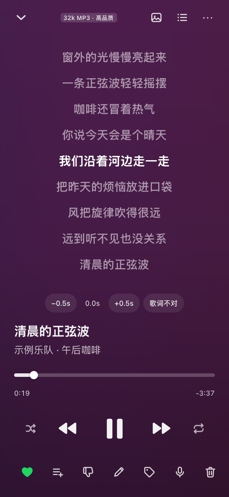

I ran Navidrome at home for a long time. The server was never the problem. The phone was: every client I tried had its own bugs, and they always showed up in the same two places, playing in the background and playing in the car. My family uses music mostly in the car and on walks, so "it works when the screen is on" wasn't good enough.

So I built my own server and its apps together, and called it **Melarka**. It has replaced Spotify for us. This post is how it's put together and what I learned. It's open source (AGPL-3.0): [github.com/aaronsuns/melarka](https://github.com/aaronsuns/melarka).

> **AI disclosure:** Melarka was built with a lot of help from Claude Code, and this post was drafted with Claude too. I designed it, steer it, review what goes in, and test it on our phones every day.



## What it does

- **Your folders, untouched.** Point it at the music you already have. It never rewrites files or tags; titles, tags, lyrics and fixes live in its own database.
- **An account per person.** Everyone at home gets their own favorites, playlists, personal radio and nightly picks.
- **Synced lyrics**, and anyone can nudge lyrics that run early or late.
- **Native apps.** An Android app in Kotlin and an iPhone app: background play, lock-screen and car controls, gapless, and an offline cache of favorites.
- **Car autoplay.** When the phone connects to the car over Bluetooth, the favorites start playing by themselves, and the current lyric line shows on the car's display.
- **Optional YouTube.** Search YouTube or follow channels, and download songs into your own library with yt-dlp.

## How it's built

The server is one Go binary with SQLite, shipped as one Docker container. Install is one command:

```bash
curl -fsSL https://raw.githubusercontent.com/aaronsuns/melarka/main/deploy/install.sh | sh -s -- /path/to/your/music
```

It streams the original file, or transcodes to AAC on the fly with ffmpeg when the phone needs it.

The web app is React. The phone apps are a mix that turned out to be the main design decision: **the screens are the server's own web app, and playback is native.** The page sends "play this queue" to the native side over a small bridge; the native player (Media3 on Android, AVFoundation on iOS) owns the audio, the lock screen and the car.

That split is why it works in the car. The web page can die, the screen can be off, the app can be in the background, and the music keeps going, because nothing about playback depends on the page. And every new server feature shows up in the apps on day one, because the screens come from the server.

## Things that took the longest

- **Never starting music on its own.** A player that resumes when a Bluetooth device connects is a nice feature in the car and a terrible one at 6 a.m. in a quiet house. The rule now: only a person (or the car autoplay they turned on) starts sound, and there are tests for every path that can start playback.
- **Offline that actually works.** The favorites are cached on the phone and the player falls back to them when the network goes, instead of stopping or skipping through the whole queue.
- **Emulator tests in CI.** The Android app has an end-to-end test on an emulator against a real server: sign in, play a favorite, kill the page's renderer, background the app, go offline. Keeping that test reliable on CI machines was its own project.

## The honest catch

Melarka has its own API, so it is **not Subsonic-compatible**: your existing Subsonic clients won't work with it, and it only makes sense if you want its apps. It's also young, about a month public. The Android APK is on the GitHub releases page (F-Droid is submitted but waiting until the app is older), and the iPhone app installs with SideStore, not the App Store.

If you run a home server and your family still pays for Spotify, I'd love to hear what you think, and especially what breaks. A one-minute tour is on [melarka.zexa.se](https://melarka.zexa.se).
